# AeroSizer — Automated Aircraft Preliminary Sizing Workbook for Excel

An Excel workbook that sizes a complete transport aircraft from 14 input
parameters. No macros, no add-ins, no circular references.

Enter the aspect ratio, drag, field lengths, lift coefficients, cruise
condition, payload and range into the yellow cells. The workbook runs the
constraint analysis, finds the optimum design point, estimates the weights,
sizes the wing, fuselage, tail, engines and landing gear, checks the
performance and stability, and redraws the aircraft — all automatically.

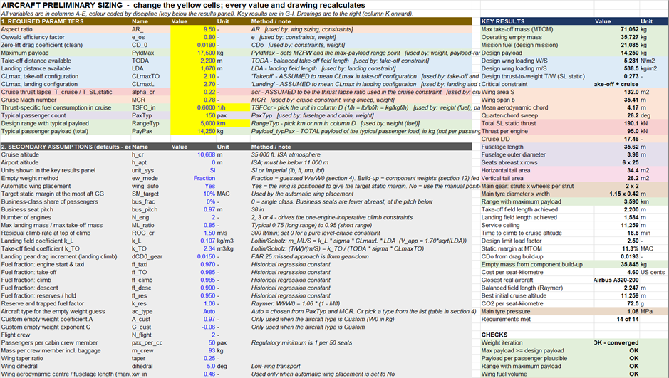

## What it does

- **Sizes from 14 numbers.** AR, e, CDo, maximum payload, TODA, LDA, CLmax
  (take-off and landing), cruise thrust lapse, cruise Mach, cruise TSFC,
  passengers, range and typical payload.
- **Finds the optimum design point.** Five constraints are drawn on a T/W
  against W/S diagram and the lowest-thrust point that meets all of them is
  solved exactly. Every later calculation uses it.
- **Draws the aircraft.** Top, side and front views to scale, a rotatable
  3D wireframe, the cabin layout with every seat, the cockpit, lavatories,
  galleys and exits, and the cabin cross-section.
- **Checks itself.** 24 pass/fail checks and a requirements compliance table
  show whether the sized aircraft actually meets what was asked for.
- **Compares and explores.** A real-aircraft comparison, a sensitivity
  study, a trade study and two stored scenarios sit beside the live design.

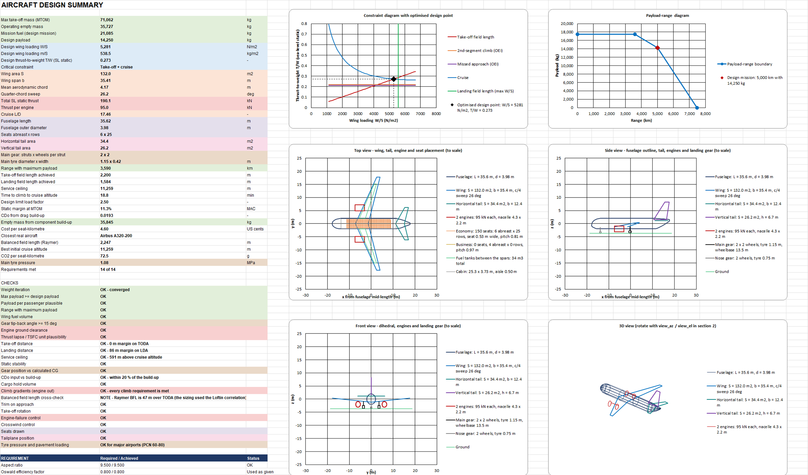

## Requirements

- Microsoft Excel 2016 or later (Windows or Mac)
- Calculation set to Automatic (the default). The trade-study and scenario
  tables are Excel data tables, so "Automatic except data tables" will leave
  them stale.

## Usage

1. Open `AeroSizer.xlsx` and go to the `Design` sheet.
2. Type your 14 parameters into the yellow cells in section 1. Pick the TSFC
   unit and the range unit (km or nm) from the dropdowns beside them.
3. Review the secondary assumptions in section 2 and change any your brief
   specifies (cruise altitude, number of engines, fuel fractions and so on).
4. Read the key results and checks in columns G–I. Drawings are to the
   right, from column K.
5. Print the `Summary` sheet for a one-page data sheet.

Colour key: yellow cells are your inputs, blue text is an editable
assumption, black text is calculated. Each section has its own colour by
discipline.

## Input parameters

| Parameter | Meaning | Unit |
|---|---|---|
| AR | Wing aspect ratio | – |
| e | Oswald efficiency factor | – |
| CDo | Zero-lift drag coefficient, clean | – |
| PyldMax | Maximum payload | kg |
| TODA | Take-off distance available | m |
| LDA | Landing distance available | m |
| Takeoff | CLmax in take-off configuration | – |
| Landing | CLmax in landing configuration | – |
| αcr | Cruise thrust lapse, T_cruise / T_sea-level static | – |
| MCR | Cruise Mach number | – |
| TSFCcr | Cruise thrust-specific fuel consumption | 1/h, mg/(N·s) or kg/(N·s) |
| PaxTyp | Typical passenger count | – |
| RangeTyp | Design range with the typical payload | km or nm |
| Payload_typPax | Total payload of the typical passenger load | kg |

## Workbook structure

| Sheet | Contents |
|---|---|
| `Design` | Every variable in 19 colour-coded sections, the key results panel and 19 charts |
| `Summary` | One printable page: key numbers, checks, compliance and six drawings |
| `Plot_Data` | Point coordinates the charts are drawn from. Nothing to edit |

| Section | Topic |
|---|---|
| 1–2 | Required parameters and secondary assumptions |
| 3 | Constraint analysis and optimised design point |
| 4 | Weight estimation and payload-range |
| 5–10 | Wing, fuselage, tail, engines, landing gear, layout geometry |
| 11 | Performance: field lengths, climb, ceilings, V-n, engine-out, mission |
| 12 | Weight breakdown, centre of gravity, static stability, trim |
| 13 | Drag build-up, high-lift system, control surfaces |
| 14 | Exits, galleys, cross-section, cargo hold |
| 15 | Operating cost, emissions, noise limits |
| 16–19 | Real-aircraft comparison, sensitivity, trade study, compliance, scenarios |

---

# Equations

All quantities are SI unless stated. $g$ = 9.80665 m/s², $\rho_0$ = 1.225 kg/m³.

## 1. Atmosphere (ISA)

$$T = 288.15 - 0.0065\,h \quad (h \le 11\,000\ \text{m}), \qquad T = 216.65\ \text{K} \quad (h > 11\,000\ \text{m})$$

$$\rho = \rho_0 \left(\frac{T}{288.15}\right)^{4.256} \quad (h \le 11\,000), \qquad \rho = 0.3639\, e^{-(h-11000)/6341.6} \quad (h > 11\,000)$$

$$a = \sqrt{1.4 \cdot 287.05 \cdot T}, \qquad V_{cr} = M_{CR}\, a, \qquad q_{cr} = \tfrac{1}{2}\rho V_{cr}^2$$

Drag polar and induced-drag factor:

$$C_D = C_{D0} + K C_L^2, \qquad K = \frac{1}{\pi\, AR\, e}$$

## 2. Constraint analysis

All constraints are expressed as sea-level static thrust-to-weight $T/W$
against take-off wing loading $W/S$. $\sigma$ is the airport density ratio
and $N$ the number of engines.

**Landing field length** (Loftin; sets the maximum wing loading)

$$\left(\frac{m_{ML}}{S}\right) = k_L\, \sigma\, C_{L\max,L}\, s_{LDA}, \qquad \left(\frac{W}{S}\right)_{\max} = \frac{k_L\, \sigma\, C_{L\max,L}\, s_{LDA}\, g}{m_{ML}/m_{MTO}}, \qquad k_L = 0.107\ \text{kg/m}^3$$

**Take-off field length** (Loftin)

$$\frac{T}{W} \ge \frac{k_{TO}}{s_{TODA}\, \sigma\, C_{L\max,TO}} \cdot \frac{W/S}{g}, \qquad k_{TO} = 2.34\ \text{m}^3/\text{kg}$$

**Second-segment climb, one engine inoperative** ($V_2 = 1.2V_s$)

$$\frac{T}{W} \ge \frac{N}{N-1}\left(\frac{1}{(L/D)_{TO}} + \gamma_2\right), \qquad C_L = \frac{C_{L\max,TO}}{1.44}, \qquad \gamma_2 = 0.024 + 0.003\,(N-2)$$

**Missed approach, one engine inoperative** ($1.3V_s$, gear down)

$$\frac{T}{W} \ge \frac{N}{N-1}\left(\frac{1}{(L/D)_{L}} + \gamma_{MA}\right)\frac{m_{ML}}{m_{MTO}}, \qquad C_L = \frac{C_{L\max,L}}{1.69}, \qquad \gamma_{MA} = 0.021 + 0.003\,(N-2)$$

Flap drag increment in both climb cases: $\Delta C_{D0,flap} = \max(0,\ 0.05\,C_L - 0.055)$.
Landing gear adds $\Delta C_{D0} = 0.015$.

**Cruise** ($\beta$ = weight fraction at start of cruise, $\alpha$ = thrust lapse)

$$\frac{T}{W} \ge \frac{\beta}{\alpha}\left[\frac{q\,C_{D0}}{\beta\,(W/S)} + \frac{K\,\beta\,(W/S)}{q} + \frac{ROC}{V}\right] = \frac{a}{W/S} + b\,\frac{W}{S} + c$$

$$a = \frac{q\,C_{D0}}{\alpha}, \qquad b = \frac{K \beta^2}{\alpha\, q}, \qquad c = \frac{\beta\, ROC}{\alpha\, V}$$

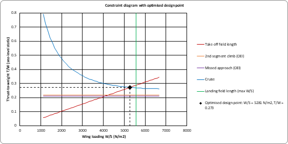

## 3. Optimised design point

The required thrust is the upper envelope of all constraints:

$$\left(\frac{T}{W}\right)_{req}(w) = \max\left(s\,w,\ \ \gamma_{floor},\ \ \frac{a}{w} + b\,w + c\right), \qquad w = \frac{W}{S} \le \left(\frac{W}{S}\right)_{\max}$$

where $s$ is the take-off slope and $\gamma_{floor}$ the higher of the two
climb requirements. This envelope is convex, so its minimum can only lie at
one of seven candidate points, which are solved in closed form:

- the landing limit $(W/S)_{\max}$
- the bottom of the cruise curve, $w = \sqrt{a/b}$
- take-off line meets cruise curve: $(b - s)\,w^2 + c\,w + a = 0$
- take-off line meets climb floor: $w = \gamma_{floor}/s$
- cruise curve meets climb floor: $b\,w^2 + (c - \gamma_{floor})\,w + a = 0$

The design point is the candidate with the lowest $T/W$; ties go to the
highest $W/S$ (smallest wing).

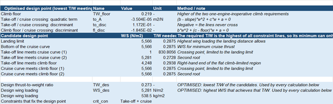

## 4. Weight estimation

**Mission fuel fraction** (historical constants, cruise from Breguet)

$$M_{ff} = \underbrace{0.970}_{\text{taxi}} \cdot \underbrace{0.985}_{\text{take-off}} \cdot \underbrace{0.985}_{\text{climb}} \cdot \underbrace{e^{-R\,c/(V\,L/D)}}_{\text{cruise}} \cdot \underbrace{0.990}_{\text{descent}} \cdot \underbrace{0.950}_{\text{reserves}}$$

$$\frac{W_f}{W_0} = 1.06\,(1 - M_{ff})$$

Cruise $L/D$ is taken at the design wing loading: $C_L = \beta\,(W/S)/q$,
$L/D = C_L/(C_{D0} + K C_L^2)$.

**Empty weight fraction** (Raymer Table 3.1; $A$ and $C$ are chosen
automatically from the aircraft type, $W_0$ in kg)

$$\frac{W_e}{W_0} = A\,W_0^{\,C}$$

| Type | A | C | Type | A | C |
|---|---|---|---|---|---|
| Jet transport | 0.97 | −0.06 | Flying boat | 1.05 | −0.05 |
| Twin turboprop | 0.92 | −0.05 | Jet trainer | 1.47 | −0.10 |
| GA single engine | 2.05 | −0.18 | Jet fighter | 2.11 | −0.13 |
| GA twin engine | 1.40 | −0.10 | Military cargo / bomber | 0.88 | −0.07 |
| Homebuilt metal / wood | 1.11 | −0.09 | Sailplane | 0.83 | −0.05 |
| Homebuilt composite | 1.07 | −0.09 | Powered sailplane | 0.88 | −0.05 |
| Agricultural | 0.72 | −0.03 | Custom | user | user |

**Take-off mass iteration** (20 steps, shown as a table)

$$W_0^{(k+1)} = \frac{W_{crew} + W_{payload}}{1 - \dfrac{W_f}{W_0} - A\left(W_0^{(k)}\right)^{C}}$$

$$W_e = \frac{W_e}{W_0} W_0, \qquad OEW = W_e + W_{crew}, \qquad MZFW = OEW + W_{pay,max}, \qquad MLW = \frac{m_{ML}}{m_{MTO}} W_0$$

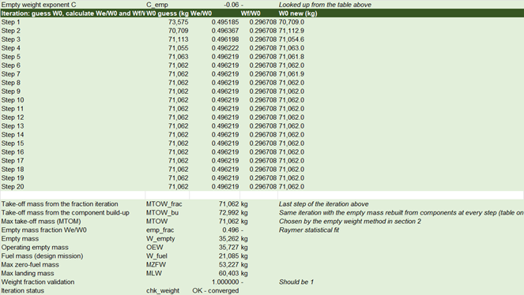

**Optional build-up method.** The same iteration can rebuild the empty mass
from components at every step instead of using the fraction:

$$W_0^{(k+1)} = \frac{W_{crew} + W_{payload} + W_e\!\left(W_0^{(k)}\right)}{1 - W_f/W_0}$$

## 5. Payload-range

For any loading with take-off mass $W_{TO}$ and fuel $W_F$, the Breguet
equation is inverted with the same fixed-segment fractions and reserves:

$$R = \frac{V\,(L/D)}{c}\,\ln\!\left[\frac{f_{fixed}}{1 - \dfrac{W_F}{1.06\,W_{TO}}}\right], \qquad f_{fixed} = 0.970 \cdot 0.985 \cdot 0.985 \cdot 0.990 \cdot 0.950$$

| Point | Payload | Fuel |
|---|---|---|
| A — maximum payload | $W_{pay,max}$ | $W_0 - OEW - W_{pay,max}$ |
| B — maximum fuel | $W_0 - OEW - W_{f,max}$ | $W_{f,max}$ |
| C — ferry | 0 | $W_{f,max}$ |

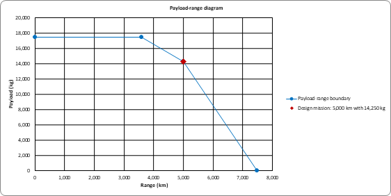

## 6. Wing

$$S = \frac{W_0\,g}{W/S}, \qquad b = \sqrt{AR \cdot S}, \qquad c_r = \frac{2S}{b\,(1+\lambda)}, \qquad c_t = \lambda\,c_r$$

$$\bar{c} = \frac{2}{3}\,c_r\,\frac{1 + \lambda + \lambda^2}{1 + \lambda}, \qquad \bar{y} = \frac{b}{6}\,\frac{1 + 2\lambda}{1 + \lambda}$$

Sweep (historical trend) and leading-edge sweep:

$$\cos\Lambda_{c/4} = \frac{0.70}{M_{CR}} \quad (M_{CR} > 0.7), \qquad \tan\Lambda_{LE} = \tan\Lambda_{c/4} + \frac{1 - \lambda}{AR\,(1 + \lambda)}$$

Thickness ratio from the Korn equation ($M_{dd} = M_{CR} + 0.02$, limited to 8–18 %):

$$\frac{t}{c} = \cos^2\!\Lambda\left[\frac{\kappa}{\cos\Lambda} - M_{dd} - \frac{C_L}{10\cos^3\!\Lambda}\right]$$

Fuel tank volume (Torenbeek) and stall speed:

$$V_{tank} = 0.54\,\frac{S^{1.5}\,(t/c)}{\sqrt{AR}}\,\frac{1 + \lambda + \lambda^2}{(1 + \lambda)^2}, \qquad V_s = \sqrt{\frac{2\,(W/S)}{\rho\,C_{L\max}}}$$

## 7. Fuselage and cabin

$$n_{SA} = 0.45\sqrt{n_{pax}}, \qquad w_{cabin} = n_{SA}\,w_{seat} + n_{aisle}\,w_{aisle} + 0.05, \qquad d_F = 1.045\,w_{cabin} + 0.084$$

$$l_{cabin} = l_{front} + n_{rows,bus}\,p_{bus} + n_{rows}\,p_{seat} + l_{rear}, \qquad l_F = l_{cabin} + 1.6\,d_F + 4\ \text{m}$$

$$S_{wet,F} = \pi\,d_F\,l_F\left(1 - \frac{2}{\lambda_F}\right)^{2/3}\left(1 + \frac{1}{\lambda_F^2}\right), \qquad \lambda_F = \frac{l_F}{d_F}$$

Lavatories: one per 50 passengers, about one third forward. Two aisles
above six abreast.

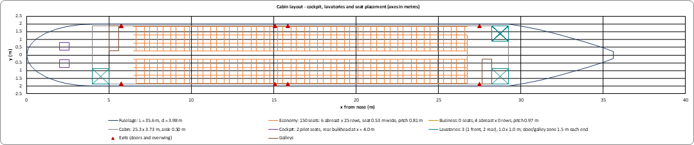

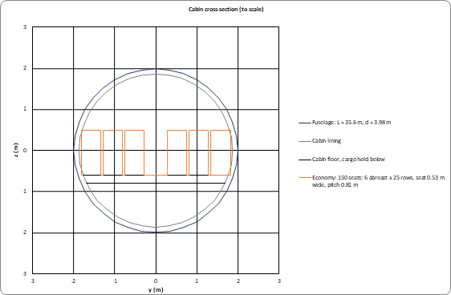

## 8. Tail (volume coefficient method)

$$S_{HT} = \frac{c_{HT}\,\bar{c}\,S}{L_{tail}}, \qquad S_{VT} = \frac{c_{VT}\,b\,S}{L_{tail}}, \qquad c_{HT} = 1.00, \quad c_{VT} = 0.09$$

## 9. Engines

$$T_{SL} = \left(\frac{T}{W}\right) W_0\,g, \qquad T_{eng} = \frac{T_{SL}}{N}, \qquad T_{cr,req} = \frac{\beta\,W_0\,g}{L/D}, \qquad T_{cr,avail} = \alpha\,T_{SL}$$

Raymer statistical turbofan scaling ($T$ in kN, mass in kg, lengths in m):

$$m_{eng} = 14.7\,T^{1.1}\,e^{-0.045\,BPR}, \qquad L_{eng} = 0.49\,T^{0.4}\,M^{0.2}, \qquad D_{fan} = 0.15\,T^{0.5}\,e^{0.04\,BPR}$$

## 10. Landing gear

Tyre size (Raymer Table 11.1, wheel load $W_w$ in lb, result in inches):

$$D = 1.63\,W_w^{0.315}, \qquad w = 0.1043\,W_w^{0.480}$$

$$\theta_{tipback} = \tan^{-1}\!\frac{l_{main}}{h_{cg}} \ge 15^\circ, \qquad track_{\min} = 2B\,\tan\!\left[\sin^{-1}\!\frac{h_{cg}}{l_{nose}\tan 63^\circ}\right]$$

$$S_{stroke} = \frac{V_v^2}{2\,g\,\eta\,N_g} - \frac{\eta_T}{\eta}\,S_T, \qquad A_p = 2.3\sqrt{w\,D}\left(\frac{D}{2} - R_r\right), \qquad p_{tyre} = \frac{W_w}{A_p}$$

The main gear is placed a distance $l_{main}$ behind the most aft centre of
gravity calculated in section 12, so the tip-back angle holds for any input.

## 11. Performance

**Field lengths achieved** (Loftin relations inverted at the design point)

$$s_{TOFL} = \frac{k_{TO}\,(W/S)/g}{\sigma\,C_{L\max,TO}\,(T/W)}, \qquad s_{LFL} = \frac{(W/S)\,(m_{ML}/m_{MTO})/g}{k_L\,\sigma\,C_{L\max,L}}$$

**Balanced field length** (Raymer eq. 17.110, SI units, 35 ft obstacle)

$$BFL = \frac{0.863}{1 + 2.3\,G}\left(\frac{W/S}{\rho\,g\,C_{L,climb}} + 10.67\right)\left(\frac{1}{T_{av}/W - U} + 2.7\right) + \frac{199.6}{\sqrt{\sigma}}$$

$$G = \gamma_{climb} - \gamma_{\min}, \qquad U = 0.01\,C_{L\max} + 0.02, \qquad \frac{T_{av}}{W} = 0.75\,\frac{T}{W}\,\frac{5 + BPR}{4 + BPR}$$

**Climb.** Thrust lapse with altitude is fitted to the cruise lapse:

$$\frac{T}{T_{SL}} = \left(\frac{\rho}{\rho_0}\right)^{n}, \qquad n = \frac{\ln\alpha}{\ln(\rho_{cr}/\rho_0)}$$

$$V_{R/C} = \sqrt{\frac{(T/W)(W/S)\,Z}{3\,\rho\,C_{D0}}}, \qquad Z = 1 + \sqrt{1 + \frac{3}{(L/D)_{\max}^2\,(T/W)^2}}$$

$$ROC = V\left[\frac{T}{W} - \frac{q\,C_{D0}}{W/S} - \frac{K\,(W/S)}{q}\right], \qquad (L/D)_{\max} = \frac{1}{2}\sqrt{\frac{\pi\,AR\,e}{C_{D0}}}$$

The absolute ceiling is where $T/W = 1/(L/D)_{\max}$; the service ceiling is
where $ROC$ = 0.5 m/s.

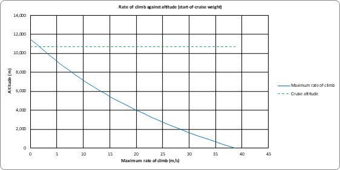

**Flight envelope.** Level-flight speed limits from thrust = drag:

$$q_{1,2} = \frac{W}{S}\,\frac{(T/W) \mp \sqrt{(T/W)^2 - 4\,C_{D0}\,K}}{2\,C_{D0}}$$

$$V_{\min} = \max\!\left(V_s,\ \sqrt{2q_1/\rho}\right), \qquad V_{\max} = \min\!\left(M_{MO}\,a,\ \sqrt{2q_2/\rho}\right)$$

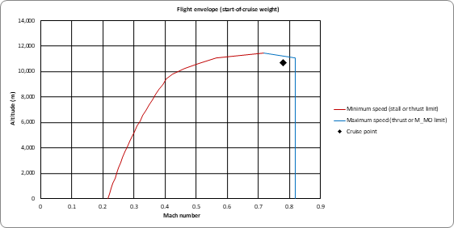

**V-n diagram** (CS-25, sea level, equivalent airspeed)

$$n_{+} = 2.1 + \frac{24\,000}{W_{lb} + 10\,000} \ \ (2.5 \le n_+ \le 3.8), \qquad n_{-} = -1, \qquad V_A = V_{S1}\sqrt{n_+}, \qquad V_D = 1.25\,V_C$$

$$n_{gust} = 1 \pm \frac{K_g\,U_{de}\,V\,C_{L\alpha}\,\rho_0}{2\,(W/S)}, \qquad K_g = \frac{0.88\,\mu_g}{5.3 + \mu_g}, \qquad \mu_g = \frac{2\,(W/S)}{\rho_0\,\bar{c}\,C_{L\alpha}\,g}$$

$$C_{L\alpha} = \frac{2\pi\,AR}{2 + \sqrt{4 + AR^2\,(1 + \tan^2\!\Lambda)}}$$

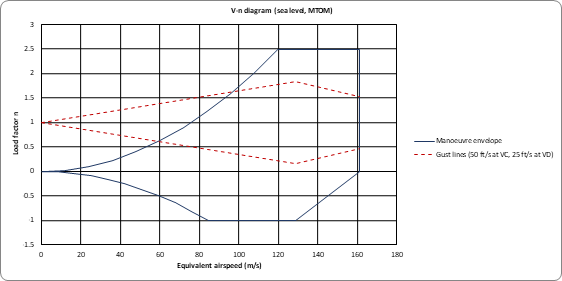

**Engine-out climb gradients** (CS 25.119 / 25.121)

$$\gamma_{OEI} = \frac{N - 1}{N}\,\frac{T}{W} - \frac{1}{L/D}$$

| Segment | Required (2 / 3 / 4 engines) |
|---|---|
| First segment | 0.0 / 0.3 / 0.5 % |
| Second segment | 2.4 / 2.7 / 3.0 % |
| Final take-off | 1.2 / 1.5 / 1.7 % |
| Approach climb | 2.1 / 2.4 / 2.7 % |
| Landing climb, all engines | 3.2 % |

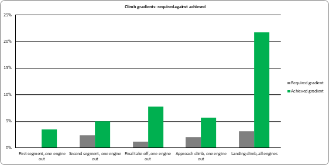

**Best cruise altitude.** Maximum $L/D$ at the cruise Mach number:

$$C_{L,opt} = \sqrt{\frac{C_{D0}}{K}}, \qquad p_{opt} = \frac{\beta\,(W/S)}{0.7\,M_{CR}^2\,C_{L,opt}}$$

and the altitude is the ISA altitude for that pressure.

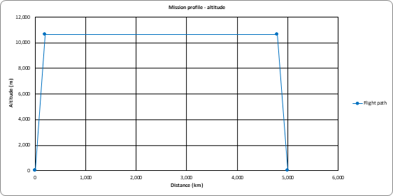

## 12. Weight breakdown, balance and stability

**Component masses** (Raymer approximate group weights)

| Component | Mass | CG position |
|---|---|---|
| Wing | 49 kg/m² × exposed area | 40 % MAC |
| Horizontal and vertical tail | 27 kg/m² × area | 40 % of own MAC |
| Fuselage | 24 kg/m² × wetted area | 45 % length |
| Landing gear | 4.3 % of MTOM (15 % nose, 85 % main) | gear stations |
| Engines, installed | 1.3 × dry engine mass | nacelle centre |
| Systems and furnishings | 17 % of MTOM | 45 % length |

$$x_{cg} = \frac{\sum m_i\,x_i}{\sum m_i}, \qquad \%MAC = \frac{x_{cg} - x_{LE,MAC}}{\bar{c}}$$

**Neutral point and static margin**

$$\frac{d\varepsilon}{d\alpha} = \frac{2\,C_{L\alpha,w}}{\pi\,AR}, \qquad \Delta x_{fus} = -\frac{1.8}{C_{L\alpha,w}}\,\frac{d_F^2\,l_{fn}}{S\,\bar{c}}$$

$$x_{np} = \frac{C_{L\alpha,w}\,(0.25 + \Delta x_{fus}) + \eta_h\,\dfrac{S_{HT}}{S}\,C_{L\alpha,h}\left(1 - \dfrac{d\varepsilon}{d\alpha}\right)\left(0.25 + \dfrac{L_{tail}}{\bar{c}}\right)}{C_{L\alpha,w} + \eta_h\,\dfrac{S_{HT}}{S}\,C_{L\alpha,h}\left(1 - \dfrac{d\varepsilon}{d\alpha}\right)}, \qquad SM = x_{np} - x_{cg}$$

**Automatic wing placement.** The balance is linear in wing position, so it
is evaluated at two trial positions $x_a$ and $x_b$ and solved directly for
the target static margin, with no circular calculation:

$$x_w = x_a + \left(SM_{target} - SM_a\right)\frac{x_b - x_a}{SM_b - SM_a}$$

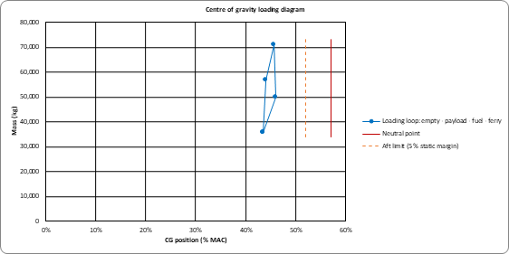

**Trim and control checks** (approximate)

$$C_{L,h,trim} = \frac{C_{m0} + C_L\,(x_{cg} - x_{ac,wb})}{\eta_h\,\bar{V}_H}, \qquad \bar{V}_H = \frac{S_{HT}\,L_{tail}}{S\,\bar{c}}, \qquad C_{L,v} = \frac{1.25 \cdot 0.9\,T_{eng}\,y_{eng}}{q_{MC}\,S_{VT}\,L_{tail}}$$

## 13. Aerodynamics

**Drag build-up** (Raymer component method)

$$C_{D0} = 1.06\,\sum_i \frac{C_{f,i}\,FF_i\,Q_i\,S_{wet,i}}{S}, \qquad C_f = \frac{0.455}{(\log_{10} Re)^{2.58}\,(1 + 0.144\,M^2)^{0.65}}$$

$$FF_{wing} = \left[1 + \frac{0.6}{0.3}\frac{t}{c} + 100\left(\frac{t}{c}\right)^4\right]\left[1.34\,M^{0.18}\cos^{0.28}\!\Lambda\right], \qquad FF_{fus} = 1 + \frac{60}{\lambda_F^3} + \frac{\lambda_F}{400}$$

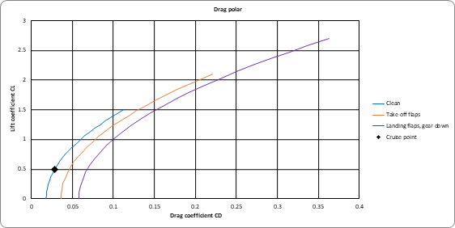

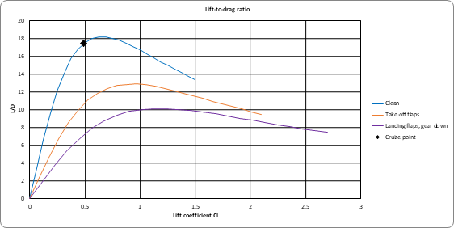

**High-lift system** (Raymer)

$$\Delta C_{l,req} = \frac{C_{L\max,L} - C_{L\max,clean}}{0.9\,(S_{flapped}/S)\,\cos\Lambda}$$

The flap type is chosen from this value: plain (≤ 0.9), single-slotted
(≤ 1.3), Fowler (≤ 1.7), double-slotted Fowler (≤ 2.0), with a leading-edge
slat above that.

## 14. Operating cost, emissions and noise

$$t_{block} = \frac{R}{V_{cr}} + 0.5\ \text{h}, \qquad W_{trip} = W_0\left(1 - f_{taxi}\,f_{TO}\,f_{climb}\,f_{cruise}\,f_{desc}\right)$$

$$C_{flight} = C_{fuel} + C_{crew} + C_{maintenance} + C_{ownership} + C_{fees}, \qquad CO_2 = 3.16\,W_{trip}$$

ICAO Annex 16 Chapter 3 noise limits ($M$ = MTOM in tonnes; these are the
limits the design must meet, not predictions):

$$L_{lateral} = 80.87 + 8.51\log_{10}M, \qquad L_{flyover} = 66.65 + 13.29\log_{10}M \ \ (\text{2 engines}), \qquad L_{approach} = 86.03 + 7.75\log_{10}M$$

Cost figures are order-of-magnitude only and use editable assumed rates.

## 15. Sensitivity, trade study and scenarios

- **Sensitivity** re-solves the take-off mass with range, payload, TSFC,
  CDo, aspect ratio or the empty weight coefficient changed by ±10 %.
- **Trade study** uses Excel data tables to re-run the whole model over a
  grid of aspect ratio and cruise Mach.
- **Scenarios** store two more sets of the 14 parameters and show their
  results beside the live design.

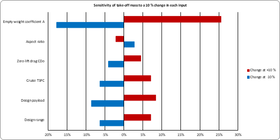

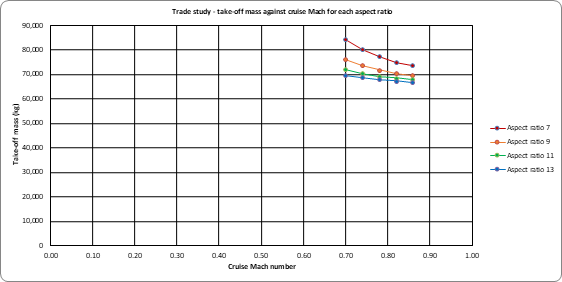

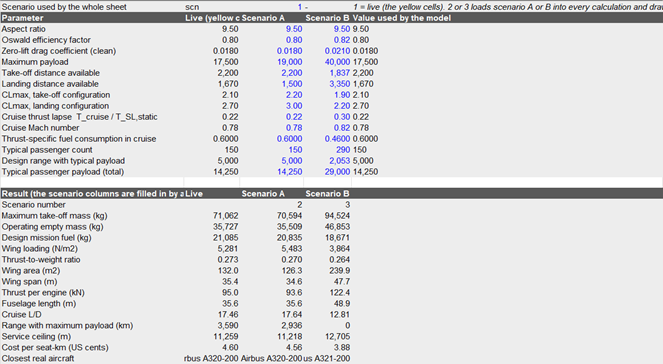

---

# Drawings

All drawings are plotted from formulas and redraw when an input changes.
The top, side and front views are to scale.

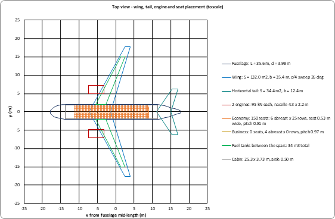

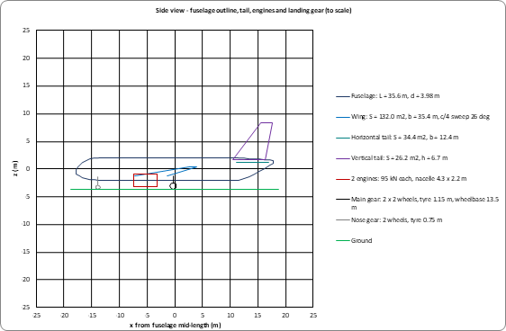

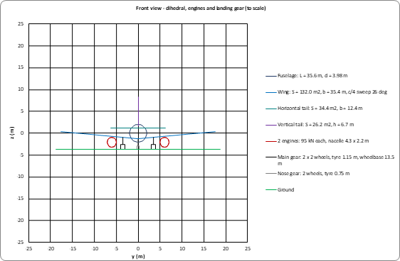

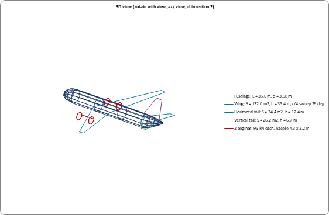

# Requirements compliance

Each input parameter is compared with what the sized aircraft achieves.

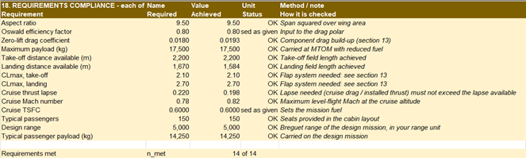

# Example

The screenshots use an A320-class example: 150 passengers, 5,000 km, Mach
0.78, TODA 2,200 m, LDA 1,670 m.

| Result | Value |
|---|---|
| Maximum take-off mass | 71,062 kg |
| Operating empty mass | 35,727 kg |
| Design mission fuel | 21,085 kg |
| Wing loading | 5,281 N/m² |
| Thrust-to-weight ratio | 0.273 |
| Wing area / span | 132.0 m² / 35.4 m |
| Fuselage length / diameter | 35.6 m / 3.98 m |
| Service ceiling | 11,259 m |
| Closest real aircraft | Airbus A320-200 |
| Requirements met | 14 of 14 |

# Limitations

- Conceptual-design methods only: statistical weights, a parabolic drag
  polar, a single thrust-lapse model and constant mission fuel fractions.
- "Takeoff", "Landing" and "αcr" are interpreted as CLmax (take-off),
  CLmax (landing) and cruise thrust lapse.
- The fuselage is sized as a passenger cabin; cargo aircraft get the right
  weight coefficients but not a cargo fuselage.
- The drag build-up is a cross-check; it is not fed back into the sizing
  automatically.
- Cost, noise, trim, control and pavement figures are approximate.
- Reference aircraft data are approximate published figures.

# References

- D. P. Raymer, *Aircraft Design: A Conceptual Approach*, AIAA.
- L. K. Loftin, *Subsonic Aircraft: Evolution and the Matching of Size to Performance*, NASA RP-1060.
- D. Scholz, *Aircraft Design* lecture notes, HAW Hamburg.
- E. Torenbeek, *Synthesis of Subsonic Airplane Design*, Delft University Press.
- J. D. Anderson, *Aircraft Performance and Design*, McGraw-Hill.
- EASA CS-25, *Certification Specifications for Large Aeroplanes*.
- ICAO Annex 16, Volume I, *Aircraft Noise*.

(disclaimer: this description was created with the help of AI)

## Author

Sajjad Mohammed — 2026.

## License

Copyright (c) 2026 Sajjad Mohammed. All rights reserved. This is **not** an
open-source project. The full terms are in [`LICENSE.txt`](LICENSE.txt).

| | You may | Condition |
|:-:|---|---|
| ✅ | View, download and run the workbook | Personal, educational, non-commercial use only |
| ✅ | Edit a copy | For your own private study only |
| ✅ | Keep a copy | The licence file and copyright notice must stay with it |

| | You may not | Consequence |
|:-:|---|---|
| ❌ | Submit it for academic assessment, edited or not | Breach of licence, may be reported to your institution, agreed damages of **£1,000 per submission** |
| ❌ | Present it as your own work | Breach of licence |
| ❌ | Redistribute it, free or paid | Needs the author's written permission |
| ❌ | Use it commercially | Needs a written agreement with the author first |
| ❌ | Design, build or operate a real aircraft from it | Prohibited; the calculations are illustrative only |

> [!WARNING]
> **Students:** entering your own numbers does not make this your work.
> Submitting this workbook, or any edited, renamed or rebuilt version of it,
> for coursework is a breach of the licence.

> [!NOTE]
> **No warranty, no liability.** The workbook is provided as is and must not
> be relied upon for the design of any real aircraft.

Commercial or licensing enquiries: [github.com/BleoSMV](https://github.com/BleoSMV)
